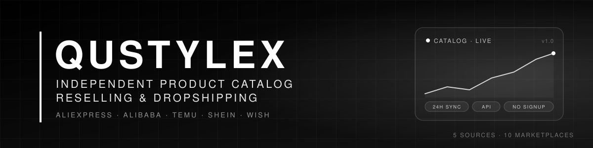

  

  
  
  

> **Qustylex** is an independent catalog of verified products for reselling and dropshipping. It indexes products from AliExpress, Alibaba, Temu, Shein and Wish, adds a profit calculator, and points you to the original marketplace. No registration, no course, no promise of earnings.

---

No registration. No course. No promise of earnings.

## What Qustylex does

- Indexes products from five international suppliers.
- Stores only what is needed to display a product and route you to the purchase: title, price, images, category, marketplace name, and original page URL.
- Updates prices and images every 24 hours.
- Provides an interactive profit calculator (price / commission / shipping → margin and profit).
- Exposes an API to query the catalog, for resellers and store operators.

## What Qustylex does not do

- It is not a shop: no cart, no checkout, no payments, no returns, no shipping.
- It does not run or resell the suppliers' products itself.
- It does not certify quality, availability, or legality of any listing.
- It does not promise earnings and does not provide business advice.

## How it works

1. **Search** — Products are found on AliExpress, Alibaba, Temu, Shein and Wish, with the real supplier cost.
2. **Publish** — Each card shows supplier cost, market price, sales volume, and a profit calculator.
3. **Choose** — Open the marketplace, filter by category and supplier, click *Vedi offerta*, and complete the purchase on the original marketplace.

## Suppliers

| Supplier | Best for |
| :--- | :--- |
| **AliExpress** | Quick tests, products under €15, no minimum quantity |
| **Alibaba** | B2B stock from manufacturers, better per-unit price, customs experience required |
| **Temu** | Local warehouses, better delivery times, less product choice |
| **Shein** | Fashion and accessories, high sales volumes, competitive prices |
| **Wish** | Generalist breadth, low prices |

## Resale marketplaces

Amazon · eBay · TikTok Shop · Zalando · Etsy · Shopify — plus the five supplier marketplaces themselves.

## Catalog

| Metric | Value |
| :--- | :--- |
| Indexed products | ~12,000 (indicative) |
| Marketplace sources | 4 (Temu, Shein, AliExpress, Alibaba) |
| Suppliers listed | 5 |
| Resale marketplaces | 10 |
| Sync frequency | Every 24 hours |

The homepage live counters display the current state of the catalog; the figures above are indicative and describe the intended scale. If the two disagree, the live counters are authoritative for the present moment.

## Prices and availability

Qustylex shows the state of a product at the time of the last catalog update. The definitive price is always the one displayed by the marketplace at the moment of purchase. Prices and availability can change between updates.

## Documentation and API

The documentation is intended for two audiences: users comparing products across marketplaces, and developers or resellers who need an API to query the catalog.

- Docs: [qustylex.vercel.app/docs](https://qustylex.vercel.app/docs)
- Marketplace: [qustylex.vercel.app/marketplace](https://qustylex.vercel.app/marketplace)

## Access

The homepage, the marketplace, and the documentation are protected by an anti-bot verification gate. No account is required to browse the catalog.

## Known points

- The supplier count is stated as five on the homepage and four in the technical documentation.
- The product count is stated as ~12,000 in the documentation, while the homepage live counters currently read zero.
- The term "marketplace" is used both for the sourcing marketplace (AliExpress, Temu, etc.) and for the resale marketplace (Amazon, eBay, etc.).

## Contributing

Report broken links, outdated prices, or misdescribed entries through the issue tracker. Do not open public issues for security problems.

## License

License not yet published. Third-party products, images, and listings referenced by Qustylex remain under their respective owners' terms.

---

  <strong>Find the product. Do the math. Decide for yourself.</strong>

  Qustylex · Catalog v1.0

