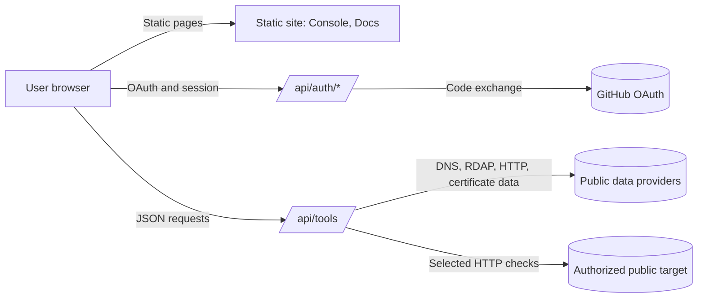

<p align="center">
  
</p>

<p align="center">
  
  
  
  
</p>

<h1 align="center">Qustylex</h1>

<p align="center"><strong>A research workspace for clear, responsible security work.</strong></p>

<p align="center">
  <a href="https://qustylex.vercel.app">Live site</a> ·
  <a href="https://qustylex.vercel.app/docs">Documentation</a> ·
  <a href="https://qustylex.vercel.app/console">Console</a>
</p>

---

## Table of Contents

1. [Overview](#1-overview)
2. [Key Capabilities](#2-key-capabilities)
3. [Who Qustylex Is For](#3-who-qustylex-is-for)
4. [Responsible Use](#4-responsible-use)
5. [Getting Started](#5-getting-started)
6. [The Console](#6-the-console)
7. [URL Scanner](#7-url-scanner)
8. [Network Intel](#8-network-intel)
9. [OSINT Arsenal and Security Directory](#9-osint-arsenal-and-security-directory)
10. [Authentication and Sessions](#10-authentication-and-sessions)
11. [API Reference](#11-api-reference)
12. [Architecture](#12-architecture)
13. [Security Model](#13-security-model)
14. [Data Handling and Privacy](#14-data-handling-and-privacy)
15. [Known Limitations and Open Items](#15-known-limitations-and-open-items)
16. [Frequently Asked Questions](#16-frequently-asked-questions)
17. [Glossary](#17-glossary)
18. [Contributing and Reporting Security Issues](#18-contributing-and-reporting-security-issues)
19. [License](#19-license)
20. [Changelog](#20-changelog)

---

## 1. Overview

Qustylex is a web-based workspace for security and open-source intelligence (OSINT) research. It brings three things into one place:

- **A focused web assessment workflow**, the URL Scanner, which runs selected checks against a public web target that the user is authorized to assess.
- **Public-data lookups**, the Network Intel module, which queries public DNS, RDAP (the modern successor to WHOIS), IP-intelligence, and certificate-transparency sources.
- **A curated directory** of 2,481 security and OSINT resource entries, organized by category, so that researchers can find established external tools and references without searching across dozens of sites.

Qustylex is a discovery and analysis aid. It does not replace professional judgment, and it does not install, host, or execute the third-party tools listed in its directory. Each directory entry is a link with a description. Opening an entry takes the user to the provider's own site, where installation, accounts, pricing, and terms are controlled by that provider.

The current release is **Qustylex v1.0**. Its documentation was last updated in October 2026.

### Design goals

| Goal | What it means in practice |
| :--- | :--- |
| **Clarity** | Every module states what it checks, what data source it uses, and what its results do not prove. |
| **Traceability** | Results are presented with their inputs and sources so that they can be reviewed and reproduced. |
| **Restraint** | Active checks are limited in scope, and the documentation asks users to stay within authorization. |
| **Honesty about limits** | Automated output is treated as a lead to verify, not as a verdict. |

---

## 2. Key Capabilities

| Capability | Summary | Requires sign-in |
| :--- | :--- | :---: |
| **URL Scanner** | Selected HTTP, DNS, technology, security-header, WAF, and public-surface checks for an authorized web target. | Yes |
| **Network Intel** | IP geolocation, reverse DNS, RDAP registration data, certificate-transparency hosts, and subdomain enumeration from public logs. | Yes |
| **OSINT Arsenal** | A searchable directory of 2,481 external OSINT and security resource entries. | Yes |
| **Security Tools** | A directory of external references for defensive assessment, forensics, cryptography, and privacy. | Yes |
| **Documentation** | Searchable guides, API reference, architecture notes, FAQ, and glossary. | No |

Access to the console and to the tool API is described in [Authentication and Sessions](#10-authentication-and-sessions). Note the open item in [Section 15](#15-known-limitations-and-open-items) about how the tool API enforces sessions.

---

## 3. Who Qustylex Is For

Qustylex is designed for people who work with public digital information in a lawful and accountable way:

- **Owners and administrators** who want to review the public exposure of systems they control, such as domains, certificates, DNS records, and web security headers.
- **Security professionals** working under a written engagement, with a defined scope, time window, and rules of engagement.
- **Bug bounty researchers** who work strictly within the scope and rules of a published program.
- **OSINT researchers and digital investigators** who need a structured starting point and who respect the privacy of the people and organizations they research.
- **Students and learners** who want to understand how public data sources, web headers, and certificates work, using systems they own or environments built for practice.

Qustylex is not intended for anyone who wants to target systems, accounts, or individuals without permission. See the next section.

---

## 4. Responsible Use

Qustylex aggregates and organizes public information, and it runs a limited set of active checks. Public availability is not permission. Before using any feature, users should be able to answer three questions:

1. **Am I authorized?** Do I own this asset, or do I have explicit written permission from its owner to assess it?
2. **Is my scope defined?** Do I know exactly which domains, hosts, or IP ranges, which checks, and which time window are covered?
3. **Is my purpose legitimate and proportionate?** Am I collecting only what I need, and am I prepared to handle what I find responsibly?

### Principles

- **Authorization first.** Run active checks only against assets you own or have explicit written permission to test.
- **Low impact.** Avoid repeated or high-volume requests. Stop if a service becomes unstable or if the owner asks you to stop.
- **Protect people and data.** Do not use the platform or its directory to stalk, dox, harass, intimidate, or discriminate against anyone, and do not use it to access accounts or private data.
- **Disclose responsibly.** If you find a vulnerability in a system you do not own, report it privately to its owner through the published security contact, share only the minimum evidence needed, and do not continue testing beyond your authorization.

### What Qustylex does not do

- It does not bypass authentication, authorization, or access controls on third-party systems.
- It does not provide a full penetration test, and it does not certify that a system is secure.
- It does not guarantee that any directory link is current, safe, or endorsed.

Laws, contracts, and provider terms vary by jurisdiction. This documentation is not legal advice.

---

## 5. Getting Started

### 5.1 Sign in

1. Open [qustylex.vercel.app](https://qustylex.vercel.app).
2. Choose **Continue with GitHub**.
3. Review the requested permissions on GitHub's consent screen. The current implementation requests the `read:user` scope only, which reads public profile information. It does not request repository or email access.
4. After authorization, you are redirected to the console at `/console`.

### 5.2 Run your first check

1. Open **URL Scanner** from the console sidebar.
2. Enter only a domain or URL that you own or are explicitly authorized to assess.
3. Start the scan and wait for the results.
4. Review each result in context. Treat every finding as a lead to verify, not as a confirmed vulnerability.
5. Document what you verified, how you verified it, and what remains uncertain.

### 5.3 Explore the directory

1. Open **OSINT Arsenal** or **Security Tools**.
2. Filter or browse by category.
3. Open an entry to read its description, then visit the provider's site to review its license, documentation, privacy practices, and current status before use.

---

## 6. The Console

The console at `/console` is the operating area of the platform. Its sidebar groups modules by purpose.

| Group | Modules | Purpose |
| :--- | :--- | :--- |
| **Overview** | Home, Dashboard, Explore, Search | Daily entry point, discovery, and search across the directory. |
| **My Work** | Overview, Pulse, Favorites, Marked, Recent | Personal shortcuts and local workspace views. |
| **Scanner** | URL Scanner | Web assessment for authorized targets. |
| **Intelligence** | OSINT, Network | Public-data lookups and directory categories for open-source research. |
| **Defense** | Privacy, Cryptography, Forensics | Directory references for defensive and privacy work. |
| **Offense** | Web Security, Exploitation, All Tools | Directory references for authorized testing and security education. |

The sidebar's grouping reflects where a resource is typically used. A directory entry in the Offense group is a reference for authorized testing and learning. It is not a license to test any system.

### Keyboard shortcuts

The documentation site supports the following shortcuts:

| Key | Action |
| :--- | :--- |
| `⌘K` / `/` | Open search |
| `?` | Show shortcuts |
| `J` / `K` | Next or previous section |
| `G` then `H` | Go to top |
| `Esc` | Close a modal |

---

## 7. URL Scanner

The URL Scanner is a web-assessment workflow for a single public URL or domain. It combines selected checks, runs them through the Qustylex tool API, and presents structured results.

**The scanner is not a penetration test.** It reports selected signals. A missing finding does not mean a site is secure, and a reported signal does not mean a site is vulnerable.

### 7.1 Checks

| Check | What it does | How to read the result |
| :--- | :--- | :--- |
| **Security headers** | Checks for HTTP response headers such as HSTS, Content-Security-Policy, X-Frame-Options, and Referrer-Policy. | A missing header is a configuration observation. Assess it against the application's actual needs. |
| **WAF detection** | Looks for fingerprints of common web application firewalls and CDN layers. | A detection indicates a likely provider, not a guarantee of protection. |
| **Technology stack** | Identifies likely CMS, framework, and server software from public responses. | Version guesses can be wrong. Verify before relying on them. |
| **Public web surface** | Requests a bounded set of common paths and reviews response metadata. | A response is evidence to review. It is not proof of exposure or exploitability. |
| **Input-handling signals** | Runs a limited check for selected database error patterns. | This is not a comprehensive injection test. Use it only inside an explicit authorization. |
| **Client-visible strings** | Searches fetched public content for selected token-like patterns. | Matches can be false positives. If a value looks like a real credential, do not use it. Notify the owner. |

### 7.2 Active versus passive checks

Several checks send requests to the target. Treat the scanner as **active testing**. This is why the documentation requires written authorization before use, and why the scope should be confirmed before every scan.

### 7.3 Interpreting results

1. **Confirm scope.** Make sure the target is inside your authorization.
2. **Read each result in context.** Consider whether the signal applies to this system, this configuration, and this purpose.
3. **Verify manually and safely.** Reproduce the signal with the least intrusive method that works, within scope.
4. **Document.** Record the check, the result, your verification steps, and your conclusion, including what you could not confirm.
5. **Report.** If the finding is real and affects a system you do not own, send it to the owner through their published disclosure channel.

### 7.4 Limits

- Results depend on the target's current response, the network path, and the availability of upstream services.
- Some checks may be blocked, rate-limited, or altered by the target's own defenses.
- Results are a snapshot at the time of the scan.

---

## 8. Network Intel

Network Intel provides lookups for IP addresses, domains, and infrastructure. It aggregates public data so that common reconnaissance questions can be answered from a single interface.

| Module | Description | Typical question |
| :--- | :--- | :--- |
| **IP geolocation** | City, country, ISP, ASN, and timezone for an IPv4 or IPv6 address. | Which network and region does this address belong to? |
| **Reverse DNS** | Hostnames that point back to an IP address. | What names are associated with this address? |
| **WHOIS and RDAP** | Registration data for IP ranges and domains, where published. | Who registered this domain or block, and when? |
| **Certificate transparency** | Hostnames listed in public certificate-transparency logs (for example, via crt.sh). | What hosts have certificates issued for this domain? |
| **Subdomain enumeration** | Subdomains discovered from public certificate and DNS data. | What names exist under this domain in public records? |

### 8.1 Interpreting Network Intel data

- **Registration data can be redacted.** Privacy services and regional rules often hide personal details. An absent field is not an error.
- **Certificate transparency shows issued certificates, not live services.** A hostname may be retired, unused, or never resolved.
- **Geolocation is approximate.** IP-based location can reflect the provider's network, not the user's physical location.
- **Providers have their own terms and rate limits.** Results can be delayed or incomplete.

---

## 9. OSINT Arsenal and Security Directory

The directory contains **2,481 curated entries** across OSINT, network research, privacy, defensive security, forensics, and related topics. Its entries are independently maintained projects and services, described and linked by Qustylex.

### 9.1 What a directory entry is

A directory entry contains a name, a short description, a category, and a link to the provider. Entries are references, not software bundled with Qustylex.

- Qustylex does not install these tools.
- Qustylex does not run them in a hosted environment for users.
- Qustylex does not control their availability, pricing, accounts, or privacy practices.

### 9.2 Categories

Categories include the following areas. Names are indicative and may change as the directory is updated.

| Area | Typical topics |
| :--- | :--- |
| **Username and identity research** | Public account discovery and cross-platform username checks. |
| **Email research** | Public email-related lookups and verification references. |
| **Breach data** | Services that report whether credentials or identifiers appear in known public breach collections. |
| **Geolocation** | Map, satellite, and imagery references, and tools for verifying where media was captured. |
| **Dark web research** | Public search and threat-intelligence references for studying illicit ecosystems. |
| **Network and domain research** | DNS, certificate, IP, and infrastructure references. |
| **Forensics** | Analysis, carving, memory, and firmware reference tools. |
| **Cryptography** | Encryption, hashing, and verification references. |
| **Privacy and operational security** | Browsers, privacy utilities, and exposure-reduction practices. |
| **Security tools** | General defensive, assessment, and learning references. |

### 9.3 Using the directory responsibly

- **Check the provider before use.** Review the license, documentation, privacy notice, and current maintenance status.
- **Do not assume a link is current or safe.** Projects can be archived, renamed, or compromised. Verify the source before installing anything.
- **Respect the purpose.** A tool's existence in a directory does not authorize its use against any system or person.
- **Breach and dark web resources** carry particular risk. Handle their outputs as sensitive, and do not expose personal data beyond what your authorized purpose requires.

---

## 10. Authentication and Sessions

Qustylex uses **GitHub OAuth 2.0** as its identity provider. Users do not create a separate Qustylex password.

### 10.1 Sign-in flow

1. **Initiation.** The user selects *Continue with GitHub*. The server creates a random `state` value, stores it in a cookie, and redirects the user to GitHub.
2. **Authorization.** The user approves access on GitHub. GitHub redirects back with a temporary `code` and the original `state`.
3. **Verification.** The server checks that the returned `state` matches the stored value and that the issuer matches GitHub's OAuth server. A mismatch stops the flow.
4. **Token exchange.** The server exchanges the `code` for a short-lived access token and uses it to retrieve the user's profile. The token is not stored in the session and is not returned to the browser.
5. **Session creation.** The profile fields needed by the console are placed in a signed cookie.

### 10.2 Scopes

| Scope | Purpose | Data read |
| :--- | :--- | :--- |
| `read:user` | Read public profile information. | Username, ID, display name, avatar, bio, public repository count, follower and following counts, profile URL. |

### 10.3 Session cookie

| Property | Value |
| :--- | :--- |
| Name | `qstx_user` |
| Format | `<base64(JSON payload)>.<hex(HMAC-SHA256)>` |
| Flags | `HttpOnly; Secure; SameSite=Lax` |
| Maximum age | 7 days (604,800 seconds) |

The payload is **base64-encoded and signed**, not encrypted. Signing protects integrity: a modified cookie is rejected. It does not hide the contents. Do not assume that the cookie is confidential.

### 10.4 Signing out and revoking access

- **Signing out** clears the browser cookie.
- **Revoking access** is done in GitHub under *Settings → Applications → Authorized OAuth Apps*. This is the provider-side control that removes the grant. Local sign-out alone does not revoke the GitHub authorization.

---

## 11. API Reference

The Qustylex API is a JSON HTTP API served from the same domain as the website.

**Base URL:** `https://qustylex.vercel.app/api`

### 11.1 Authentication

The console and the tool endpoints are designed to require a valid, unexpired session cookie. Requests without a valid session receive `401 Unauthorized`. Browser requests on the same origin send the cookie automatically. Command-line requests must include the cookie explicitly.

See [Known Limitations](#15-known-limitations-and-open-items) for an open item about how `/api/tools` enforces this requirement.

### 11.2 `GET /api/auth/me`

Returns the profile of the authenticated user. The client uses this endpoint to confirm that a session is still valid.

```http
GET /api/auth/me
Cookie: qstx_user=<signed value>
```

```javascript
const response = await fetch('/api/auth/me', {
  credentials: 'same-origin',
  cache: 'no-store',
  headers: { Accept: 'application/json' }
});
```

| Status | Meaning |
| :--- | :--- |
| `200 OK` | Valid session. The response contains the user object. |
| `401 Unauthorized` | No session, invalid signature, or expired session. |
| `500 Internal Server Error` | Server misconfiguration or internal error. |

### 11.3 `GET /api/tools`

Routes a lookup or assessment request to a supported tool.

| Parameter | Required | Type | Description |
| :--- | :---: | :--- | :--- |
| `type` | Yes | string | The route identifier, for example `domain-full`, `dns-all`, or `whois`. |
| `q` | Yes | string | The target: a domain, IP address, or URL. |
| `record` | No | string | Optional for routes that accept a DNS record type, such as `dns-propagation`. |

**Example: DNS lookup** (requires a session cookie)

```bash
curl -X GET "https://qustylex.vercel.app/api/tools?type=dns-all&q=example.com" \
  -H "Accept: application/json" \
  -H "Cookie: qstx_user=<your signed session value>"
```

**Example: domain assessment** (requires a session cookie, and an authorized target)

```bash
curl -X GET "https://qustylex.vercel.app/api/tools?type=domain-full&q=example.com" \
  -H "Accept: application/json" \
  -H "Cookie: qstx_user=<your signed session value>"
```

Use only domains you own or are explicitly authorized to assess. Route names and parameters may change between releases; check the current documentation before integrating.

### 11.4 Error responses

Every error response uses the same JSON shape:

```json
{
  "ok": false,
  "error": "bad_request",
  "message": "Missing required parameter: q"
}
```

| HTTP status | Error code | Cause |
| :---: | :--- | :--- |
| `400` | `bad_request` | A required parameter (`type` or `q`) is missing or malformed. |
| `401` | `unauthorized` | No valid, unexpired session. |
| `403` | `forbidden` | The target is a private or local address that the handler blocks. |
| `404` | `not_found` | The route identifier is unknown. |
| `405` | `method_not_allowed` | The request method is not `GET`. |
| `500` | `server_error` | An upstream provider or the tool handler failed. |

### 11.5 Rate limits

The current tool handler does not implement an application-level rate limiter. Hosting or upstream provider limits may still apply. Do not design integrations that depend on a specific limit, and keep request volume low.

---

## 12. Architecture

Qustylex is a static web application with serverless API routes. Authentication and tool routes run as serverless functions on the hosting platform. Live results depend on external data providers.



### 12.1 Components

| Component | Responsibility |
| :--- | :--- |
| **Static site** | Landing page, documentation, and console user interface. |
| **Auth routes** | GitHub OAuth initiation, callback, session creation, and the `/api/auth/me` profile check. |
| **Tool routes** | Route dispatch for the URL Scanner and Network Intel lookups. |
| **Directory** | Static catalog of 2,481 external entries with descriptions and links. |
| **Upstream providers** | Public DNS, RDAP, IP-intelligence, certificate-transparency, and web sources used by live lookups. |

### 12.2 Design principles

- **Separation of concerns.** Static content, authentication, and tool execution are separate.
- **Small server surface.** Serverless routes handle only what the features require.
- **Explicit scope.** Active checks are described as active, and their use is governed by the authorization rules in this document.

---

## 13. Security Model

This section describes the intended controls and the threats they address. It is not a security certification. Verify the deployed service independently before making security claims about it.

### 13.1 Controls

| Control | Purpose |
| :--- | :--- |
| **OAuth state validation** | Prevents cross-site request forgery during sign-in. |
| **Issuer check** | Confirms the authorization response came from GitHub's OAuth server. |
| **Signed session cookie** | Detects tampering with the session payload. |
| **Seven-day session limit** | Limits how long a stolen or forgotten session remains valid. |
| **`HttpOnly` cookie** | Prevents page scripts from reading the cookie value directly. |
| **`Secure` cookie** | Restricts the cookie to HTTPS connections. |
| **`SameSite=Lax`** | Reduces cross-site request forgery risk while allowing normal navigation. |
| **Private-address blocking** | The tool handler rejects private and local addresses, as reported in the error table. |

### 13.2 Threats in scope

- Credential theft through cross-site scripting or cross-site request forgery.
- Session hijacking through cookie theft.
- Unauthorized data access through broken authorization.
- Injection attacks, including SQL, command, and template injection.
- Abuse through excessive requests or resource exhaustion.
- Attacks on the OAuth flow, such as code interception or mix-up.

### 13.3 Threats out of scope

- Physical attacks on users or their devices.
- Compromise of GitHub or of the user's own endpoint.
- Legal compulsion of infrastructure providers.

### 13.4 Limits of this model

- A signed cookie is not encryption. Its contents are readable by anyone who has it.
- `HttpOnly` does not protect against malicious scripts running on the same origin.
- Application security depends on the deployed configuration, hosting platform, and upstream providers.

---

## 14. Data Handling and Privacy

The repository and documentation describe some data handling. Hosting logs, backups, provider retention, and production settings are controlled by the deployment and by upstream providers. The operator should publish a deployment-specific privacy notice that covers these details.

| Data | Purpose | Retention |
| :--- | :--- | :--- |
| **GitHub profile fields** | Identify and display the signed-in user. | Stored in the session cookie for up to seven days. |
| **GitHub access token** | Used once to retrieve the profile. | Discarded after the profile lookup. Not stored in the cookie or returned to the browser. |
| **Lookup and scan inputs** | Sent to the tool API and, depending on the check, to public data providers or the target. | Not established by this repository. Verify the deployed service and each provider's policy. |

### 14.1 Your rights

To ask what data is associated with your account, to request correction, or to request deletion, contact the service operator through its published privacy channel. Completion times and outcomes depend on the deployed service and on applicable law.

Profile fields come from GitHub. To change them, update your GitHub profile and sign in again.

### 14.2 What you should not submit

- Credentials, secrets, or API keys belonging to anyone.
- Personal data about third parties unless you have a lawful, specific purpose.
- Confidential information of an employer or client without authorization.

---

## 15. Known Limitations and Open Items

This section lists issues the maintainers should resolve or verify before a wider release. Readers should weigh these items when relying on the platform.

| # | Item | Current state | Action |
| :---: | :--- | :--- | :--- |
| 1 | **Session enforcement on `/api/tools`** | The documentation says the route requires a valid session. The handler description in the same documentation says it does not verify one. | Verify in the deployed code. Enforce the session check server-side and test it with an unauthenticated request. |
| 2 | **Rate limiting** | No application-level rate limiter is documented for the tool handler. | Add a per-session or per-address limit on active routes. |
| 3 | **Retention and logging** | Retention for hosting logs, upstream providers, and backups is not documented. | Publish a deployment-specific privacy notice. |
| 4 | **Account deletion** | No self-service deletion workflow is documented. | Document the request process, or add a self-service option. |
| 5 | **Directory accuracy** | Entries are external links that change over time. | Schedule periodic link and status reviews, and mark stale entries. |
| 6 | **License** | Not yet defined for the platform code or its original content. | Choose and publish a license. Third-party entries keep their own licenses. |
| 7 | **Public security contact** | Not specified in this document. | Publish a security contact and disclosure policy. |

Items 1 and 2 concern how active routes are protected. They should be resolved before any claim that the platform enforces authorization or limits abuse.

---

## 16. Frequently Asked Questions

**Is Qustylex legal to use?**
No tool can make every use lawful. Laws, contracts, provider terms, and privacy rights vary. Use active checks only on systems you own or are explicitly authorized to assess, and consult qualified legal advice when needed.

**Can I scan any website?**
No. Scan only assets you own or that are covered by written authorization. A website being reachable on the internet is not permission to test it.

**Does the URL Scanner exploit vulnerabilities?**
No. It reports selected signals. A signal is not proof that a vulnerability is exploitable, and the scanner does not provide an exploitation workflow.

**Are the scanner's checks passive?**
No. Several checks send requests to the target. Treat scanning as active testing.

**Is a scanner result a confirmed finding?**
No. Results can be incomplete, outdated, or false positives. Verify findings within your authorization.

**How many tools are in the directory?**
The directory contains 2,481 entries. These are links and descriptions for external resources, not applications that Qustylex runs.

**Can I run the directory's tools inside Qustylex?**
No. Each provider controls installation, accounts, pricing, availability, and terms.

**Are all directory links verified and working?**
No. Projects change, move, or disappear. Review each provider before relying on it.

**Does Qustylex make me anonymous?**
No. No platform or tool can guarantee anonymity. Qustylex is a research aid, not an anonymity service.

**Why does Qustylex use GitHub sign-in?**
GitHub is the only identity provider the platform uses. This avoids storing passwords for Qustylex accounts. The scope requested is listed in [Section 10.2](#102-scopes).

**Does Qustylex store my GitHub access token?**
No. The token is used once to read your profile and is then discarded.

**Is my session cookie encrypted?**
No. It is base64-encoded and signed with HMAC-SHA256. The signature protects integrity. It does not conceal the contents.

**How long does a session last?**
Up to seven days. Signing out clears the browser cookie. To revoke the GitHub grant, use GitHub's authorized applications settings.

**How do I report a security issue?**
Use the security contact published by the operator. Do not post vulnerability details publicly, and do not include real credentials or personal data in your report.

---

## 17. Glossary

| Term | Definition |
| :--- | :--- |
| **OSINT** | Open-Source Intelligence: information gathered from publicly available sources. |
| **OPSEC** | Operational Security: practices that limit unnecessary exposure of information. |
| **RDAP** | Registration Data Access Protocol: a modern, structured successor to WHOIS. |
| **WHOIS** | A protocol and service for querying domain and address registration records. |
| **DNS** | Domain Name System: translates domain names into addresses and publishes other records. |
| **Certificate transparency** | Public, append-only logs of issued TLS certificates. |
| **WAF** | Web Application Firewall: a filter that inspects web traffic for malicious patterns. |
| **HSTS** | HTTP Strict Transport Security: tells browsers to use HTTPS only for a domain. |
| **CSP** | Content-Security-Policy: restricts which resources a page may load and run. |
| **OAuth 2.0** | An authorization framework that lets a service access a user's data at a provider without a password. |
| **HMAC** | Hash-based Message Authentication Code: a signature that proves a message was not altered. |
| **Authorized scope** | The explicitly approved set of assets, checks, and time window for a test or assessment. |

---

## 18. Contributing and Reporting Security Issues

Community input helps keep the directory accurate and the documentation clear.

### 18.1 Ways to contribute

- Report broken, outdated, or misdescribed directory entries.
- Suggest well-maintained tools that fit an existing category, with the name, purpose, license, and suggested category.
- Point out documentation gaps or inconsistencies.
- Share feedback on clarity and usability.

### 18.2 Reporting a security vulnerability

Do not open a public issue for a security vulnerability. Report it privately through the security contact published by the operator, and allow reasonable time for review before any public disclosure.

> **Maintainers:** replace this placeholder with the published security contact and disclosure policy before release.

---

## 19. License

The Qustylex platform code and original content do not yet have a published license.

> **Maintainers:** choose and publish a license before public release, and state it here.

Third-party entries in the directory keep their own licenses and terms. Respect them before use or redistribution.

---

## 20. Changelog

### v1.0 (October 2026)

- GitHub OAuth sign-in with a signed, seven-day session cookie.
- URL Scanner with selected security-header, WAF, technology, public-surface, input-handling, and client-visible-string checks.
- Network Intel with IP geolocation, reverse DNS, RDAP, certificate-transparency, and subdomain lookups.
- Directory of 2,481 external OSINT and security resource entries.
- Documentation with API reference, architecture notes, threat model, FAQ, and glossary.

---

<p align="center">
  <strong>Discover with purpose. Investigate with precision. Use with responsibility.</strong>
</p>

<p align="center">
  Qustylex v1.0 · Documentation · Licensed for lawful use only
</p>
