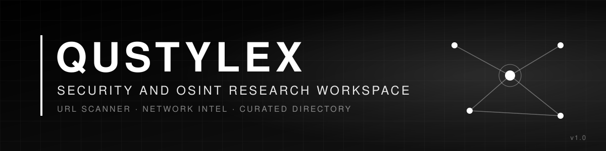
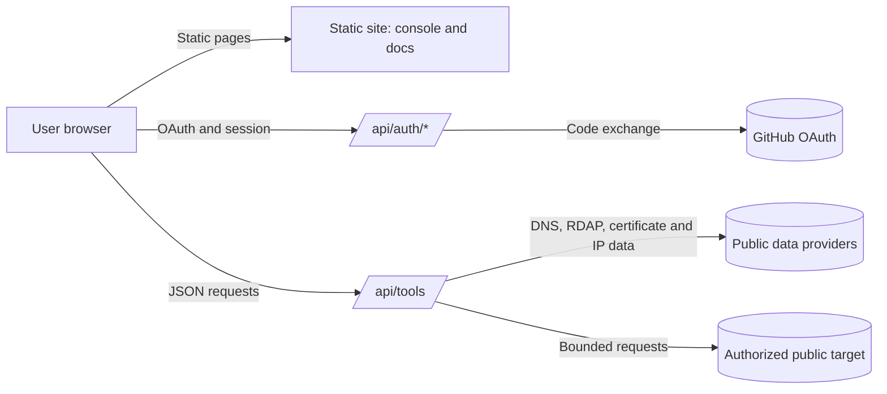

<p align="center">
  
</p>

<p align="center">
  
  
  
  
</p>

<h1 align="center">Qustylex</h1>

<p align="center"><strong>A curated research workspace for website security assessment and public-source reference.</strong></p>

<p align="center">
  <a href="https://qustylex.vercel.app">Live site</a> ·
  <a href="https://qustylex.vercel.app/docs">Documentation</a> ·
  <a href="https://qustylex.vercel.app/console">Console</a>
</p>

---

## Table of Contents

1. [Overview](#1-overview)
2. [What Qustylex Does and Does Not Do](#2-what-qustylex-does-and-does-not-do)
3. [Key Capabilities](#3-key-capabilities)
4. [Who Qustylex Is For](#4-who-qustylex-is-for)
5. [Responsible Use](#5-responsible-use)
6. [Getting Started](#6-getting-started)
7. [The Console](#7-the-console)
8. [URL Scanner](#8-url-scanner)
9. [Network Intel](#9-network-intel)
10. [Public Resource Directory](#10-public-resource-directory)
11. [Authentication and Sessions](#11-authentication-and-sessions)
12. [API Reference](#12-api-reference)
13. [Architecture](#13-architecture)
14. [Security Model](#14-security-model)
15. [Data Handling and Privacy](#15-data-handling-and-privacy)
16. [Reliability and Known Limitations](#16-reliability-and-known-limitations)
17. [Frequently Asked Questions](#17-frequently-asked-questions)
18. [Glossary](#18-glossary)
19. [Contributing and Reporting Security Issues](#19-contributing-and-reporting-security-issues)
20. [License](#20-license)
21. [Changelog](#21-changelog)

---

## 1. Overview

Qustylex is a web-based workspace for website security assessment and open-source research. It combines three things in one place:

- **URL Scanner**, a lightweight automated assessment of a public website. It sends a small, bounded set of requests to the target, looks for common weaknesses and misconfigurations, and lists what it finds.
- **Network Intel**, a set of lookups for public infrastructure data such as DNS, registration records, IP context, and certificate-transparency hostnames.
- **A public resource directory** of 2,481 curated entries that point to public tools and references hosted on GitHub, the web, and other public sources.

Qustylex is a discovery and analysis aid. It does not install, host, or run the third-party tools it lists. Each directory entry is a link with a description, and the provider controls installation, accounts, pricing, and terms.

The current platform is **version 1.0**, and the console is **version 3.2**.

### Design goals

| Goal | What it means in practice |
| :--- | :--- |
| **Clarity** | Every module states what it checks, what data it uses, and what its results do not prove. |
| **Traceability** | Results are presented with their inputs so they can be reviewed and reproduced. |
| **Restraint** | Active checks are limited in scope, and the platform asks users to stay within authorization. |
| **Honesty about limits** | Automated output is a lead to verify, not a verdict. |

---

## 2. What Qustylex Does and Does Not Do

Clarity about scope matters more than feature lists, so this section comes first.

### Qustylex does

- Run a limited, automated security assessment of a website or domain that the user is authorized to test.
- List the weaknesses and configuration issues the assessment detects, with the evidence for each.
- Run public-data lookups for DNS, registration records, IP context, and certificate-transparency hostnames.
- Organize public tools and references, hosted on GitHub, the web, and other public sources, so they are easier to find.

### Qustylex does not

- **Search for people.** It does not search usernames, email addresses, phone numbers, or personal profiles across services.
- **Trace individuals.** It does not identify, locate, or profile a person.
- **Access private data.** It does not log into accounts, read private messages, or retrieve non-public information.
- **Bypass protections.** It does not defeat authentication, authorization, or access controls on third-party systems.
- **Run the directory's tools.** Directory entries are references. Qustylex does not execute them for users.
- **Certify security.** A clean result does not mean a website is secure, and a reported finding does not prove exploitability.

---

## 3. Key Capabilities

| Capability | Summary | Requires sign-in |
| :--- | :--- | :---: |
| **URL Scanner** | Bounded automated assessment of an authorized website: headers, technology, WAF, public surface, and selected weakness indicators. | Yes |
| **Network Intel** | DNS, RDAP registration data, IP geolocation and context, reverse DNS, certificate-transparency hostnames, and subdomain discovery. | Yes |
| **Public directory** | 2,481 curated references to public tools and resources, organized by category. | Yes |
| **Documentation** | Guides, API reference, architecture notes, FAQ, and glossary. | No |

Access to the console and the tool API is described in [Section 11](#11-authentication-and-sessions). An open item about session enforcement on the tool API is listed in [Section 16](#16-reliability-and-known-limitations).

---

## 4. Who Qustylex Is For

- **Website owners and administrators** who want to review the security configuration of sites they control.
- **Security professionals** working under a written engagement, with a defined scope, time window, and rules of engagement.
- **Bug bounty researchers** who work strictly within the scope and rules of a published program.
- **Students and learners** who want to understand web security concepts, using their own sites or dedicated practice environments.
- **Researchers** who need a curated, well-described starting point for finding public tools and references.

Qustylex is not intended for anyone who wants to test systems, accounts, or people without permission.

---

## 5. Responsible Use

Public availability is not permission. Before running any active check, be able to answer three questions:

1. **Am I authorized?** Do I own this website, or do I have explicit written permission from its owner to assess it?
2. **Is my scope defined?** Do I know the exact domain or host, the checks I will run, and the time window?
3. **Is my purpose legitimate and proportionate?** Am I collecting only what I need, and am I ready to handle the results responsibly?

### Principles

- **Authorization first.** Run the URL Scanner only against assets you own or are explicitly authorized to assess.
- **Low impact.** Stop immediately if the target becomes unstable, and respect its rate limits and published rules.
- **Protect people and data.** Do not use Qustylex or its directory to stalk, harass, or expose anyone.
- **Disclose responsibly.** If you find a real weakness in a system you do not own, report it privately to its owner. Share only the minimum evidence needed, and do not test further.

Laws and contracts vary by jurisdiction. This documentation is not legal advice.

---

## 6. Getting Started

### 6.1 Sign in

1. Open [qustylex.vercel.app](https://qustylex.vercel.app).
2. Choose **Continue with GitHub**.
3. Review the requested permission on GitHub's consent screen. The platform requests `read:user` only, which reads public profile information.
4. You are redirected to the console at `/console`.

### 6.2 Run your first assessment

1. Open **URL Scanner** from the console sidebar.
2. Enter only a domain or URL you own or are explicitly authorized to assess.
3. Start the assessment and wait for the results.
4. Review each finding in context. Treat every finding as a lead to verify.
5. Record what you verified, how, and what remains uncertain.

### 6.3 Explore the directory

1. Open a category from the **Intelligence**, **Defense**, **Offense**, or **Infrastructure** groups.
2. Browse or search the entries.
3. Open an entry to read its description, then visit the provider to review its license, documentation, privacy practices, and maintenance status before using it.

---

## 7. The Console

The console (version 3.2) is the operating area of the platform. Its sidebar is organized as follows.

| Group | Contents | Purpose |
| :--- | :--- | :--- |
| **Dashboard** | Overview of the workspace. | Entry point. |
| **URL Scanner** | Website assessment for authorized targets. | Active, bounded checks. |
| **Intelligence** | OSINT, Social Media, Breach Data, Geolocation, Dark Web, Threat Intel. | Directory references for public-source research. |
| **Defense** | Privacy Stack, Cryptography, Forensics, Network Security. | Directory references for defensive and privacy work. |
| **Offense** | Web Security, Exploitation, AI Security, All Security Tools. | Directory references for authorized testing and security education. |
| **Infrastructure** | Operating Systems, Cloud and Containers, Mobile Security. | Directory references for platforms and environments. |
| **Resources** | News. | Curated updates. |

Each category shows the number of entries it contains. A reference in the **Offense** group is a resource for authorized testing and learning. It is not permission to test any system.

---

## 8. URL Scanner

The URL Scanner runs a bounded automated assessment against a single public website or domain. It performs a small set of controlled requests, in the spirit of a low-intensity vulnerability assessment, and lists the weaknesses and configuration issues it detects with the evidence for each.

**The URL Scanner is not a penetration test.** It covers a limited set of checks. It cannot prove that a site is secure, and it cannot prove that a finding is exploitable.

### 8.1 Checks

| Check | What it does | How to read the result |
| :--- | :--- | :--- |
| **Security headers** | Checks for HSTS, Content-Security-Policy, X-Frame-Options, Referrer-Policy, and related headers. | A missing header is a configuration observation. Judge it against the application's real needs. |
| **WAF detection** | Looks for fingerprints of common web application firewalls and CDN layers. | A detection indicates a likely provider, not a guarantee of protection. |
| **Technology stack** | Identifies likely server, framework, and CMS software from public responses. | Version guesses can be wrong. Verify before relying on them. |
| **Public surface** | Requests a bounded set of common paths and reviews response metadata. | A response is evidence to review. It is not proof of exposure. |
| **Input-handling signals** | Runs a limited check for selected database error patterns in responses. | Not a comprehensive injection test. Interpret carefully and verify manually within scope. |
| **Exposed strings** | Searches fetched public content for selected token-like patterns. | Matches can be false positives. Do not use any value you find. Notify the owner. |

### 8.2 How the assessment works

1. **Scope check.** The target is normalized into a domain or URL.
2. **Bounded requests.** A limited number of requests is sent to the target and to public data sources.
3. **Analysis.** Responses are compared against known indicators.
4. **Report.** Each detected item is listed with its check, evidence, and a note on its limits.

Because the assessment sends requests to the target, it is active testing. Use it only within written authorization.

### 8.3 Interpreting findings

1. **Confirm scope.** Make sure the target is inside your authorization.
2. **Read in context.** Consider whether the signal applies to this system, configuration, and purpose.
3. **Verify manually and safely.** Reproduce the signal with the least intrusive method that works, within scope.
4. **Document.** Record the check, the result, your verification steps, and your conclusion, including what you could not confirm.
5. **Report.** If a finding is real and affects a system you do not own, send it to the owner through their published disclosure channel.

### 8.4 Limits

- Results depend on how the target responds at that moment, on network conditions, and on upstream services.
- Targets may block, rate-limit, or alter responses, which can hide or distort signals.
- A result is a snapshot taken when the assessment ran.

---

## 9. Network Intel

Network Intel provides lookups for domains, IP addresses, and infrastructure. It aggregates public data so common questions can be answered from one interface.

| Module | Description | Typical question |
| :--- | :--- | :--- |
| **IP geolocation** | City, country, ISP, ASN, and timezone for an IPv4 or IPv6 address. | Which network and region does this address belong to? |
| **Reverse DNS** | Hostnames that point back to an IP address. | Which names are associated with this address? |
| **WHOIS and RDAP** | Registration data for domains and IP ranges, where published. | Who registered this domain, and when? |
| **Certificate transparency** | Hostnames listed in public certificate-transparency logs. | Which hosts have certificates issued for this domain? |
| **Subdomain discovery** | Subdomains found in public certificate and DNS data. | Which names exist under this domain in public records? |

### 9.1 Interpreting Network Intel data

- **Registration data is often redacted.** Privacy services and regional rules hide details. A missing field is not an error.
- **Certificate transparency shows issued certificates, not live services.** A hostname may be retired or never resolved.
- **Geolocation is approximate.** An IP address often resolves to the provider's network location, not a user's physical location.
- **Upstream providers set their own limits.** Results can be delayed or incomplete.

---

## 10. Public Resource Directory

The directory contains **2,481 curated entries** that point to public tools and references. Entries are maintained as links and descriptions, not as software bundled with Qustylex.

### 10.1 Entries by category

| Section | Category | Entries |
| :--- | :--- | ---: |
| **Intelligence** | OSINT | 609 |
| | Social Media | 262 |
| | Breach Data | 102 |
| | Geolocation | 300 |
| | Dark Web | 64 |
| | Threat Intel | 187 |
| **Defense** | Privacy Stack | 20 |
| | Cryptography | 195 |
| | Forensics | 427 |
| | Network Security | 195 |
| **Offense** | Web Security | 26 |
| | Exploitation | 10 |
| | AI Security | 10 |
| | All Security Tools | 38 |
| **Infrastructure** | Operating Systems | 16 |
| | Cloud and Containers | 12 |
| | Mobile Security | 8 |
| **Total** | | **2,481** |

### 10.2 What an entry is

Each entry contains a name, a short description, a category, and a link to its source. Entries typically point to public repositories on GitHub or to websites and documentation.

- Qustylex does not install these tools.
- Qustylex does not run them for users.
- Qustylex does not control their availability, pricing, accounts, or privacy practices.

### 10.3 Using the directory responsibly

- **Check the source before use.** Review the license, documentation, maintenance status, and any privacy notice.
- **Do not assume a link is current or safe.** Projects can be archived, renamed, or compromised. Verify before installing anything.
- **Respect the purpose.** A listing does not authorize use against any system or person.
- **Handle sensitive categories with care.** Breach data, dark web, and geolocation references can expose personal information. Use them only for a legitimate, proportionate purpose.

---

## 11. Authentication and Sessions

Qustylex uses **GitHub OAuth 2.0** for sign-in. No separate Qustylex password is created.

### 11.1 Sign-in flow

1. **Initiation.** The user selects *Continue with GitHub*. The server creates a random `state` value, stores it in a cookie, and redirects to GitHub.
2. **Authorization.** The user approves access on GitHub, which redirects back with a temporary `code` and the original `state`.
3. **Verification.** The server checks that `state` matches the stored value and that the issuer is GitHub's OAuth server. A mismatch stops the flow.
4. **Token exchange.** The server exchanges the `code` for a short-lived token and uses it to read the user's profile. The token is not stored in the session and is not sent to the browser.
5. **Session creation.** The profile fields needed by the console are placed in a signed cookie.

### 11.2 Scope

| Scope | Purpose | Data read |
| :--- | :--- | :--- |
| `read:user` | Read public profile information. | Username, ID, display name, avatar, bio, public repository count, follower counts, profile URL. |

### 11.3 Session cookie

| Property | Value |
| :--- | :--- |
| Name | `qstx_user` |
| Format | `<base64(JSON payload)>.<hex(HMAC-SHA256)>` |
| Flags | `HttpOnly; Secure; SameSite=Lax` |
| Maximum age | 7 days (604,800 seconds) |

The payload is **base64-encoded and signed, not encrypted**. The signature protects integrity, so a modified cookie is rejected, but the contents are readable.

### 11.4 Signing out and revoking access

- **Signing out** clears the browser cookie.
- **Revoking access** is done in GitHub under *Settings → Applications → Authorized OAuth Apps*. Signing out does not revoke the GitHub grant.

---

## 12. API Reference

**Base URL:** `https://qustylex.vercel.app/api`

### 12.1 Authentication

The console and the tool endpoints are designed to require a valid, unexpired session cookie. Requests without one receive `401 Unauthorized`. Browser requests on the same origin send the cookie automatically. Command-line requests must include it explicitly. See [Section 16](#16-reliability-and-known-limitations) for an open item about enforcement on `/api/tools`.

### 12.2 `GET /api/auth/me`

Returns the profile of the authenticated user. The client uses it to confirm the session is still valid.

```javascript
const response = await fetch('/api/auth/me', {
  credentials: 'same-origin',
  cache: 'no-store',
  headers: { Accept: 'application/json' }
});
```

| Status | Meaning |
| :--- | :--- |
| `200 OK` | Valid session. The response contains the user object. |
| `401 Unauthorized` | No session, invalid signature, or expired session. |
| `500 Internal Server Error` | Server misconfiguration or internal error. |

### 12.3 `GET /api/tools`

Routes an assessment or lookup request to a supported tool.

| Parameter | Required | Type | Description |
| :--- | :---: | :--- | :--- |
| `type` | Yes | string | The route identifier, for example `domain-full`, `dns-all`, or `whois`. |
| `q` | Yes | string | The target: a domain, IP address, or URL. |
| `record` | No | string | Optional for routes that accept a DNS record type, such as `dns-propagation`. |

**DNS lookup** (requires a session cookie)

```bash
curl -X GET "https://qustylex.vercel.app/api/tools?type=dns-all&q=example.com" \
  -H "Accept: application/json" \
  -H "Cookie: qstx_user=<your signed session value>"
```

**Domain assessment** (requires a session cookie and an authorized target)

```bash
curl -X GET "https://qustylex.vercel.app/api/tools?type=domain-full&q=example.com" \
  -H "Accept: application/json" \
  -H "Cookie: qstx_user=<your signed session value>"
```

Route names and parameters may change between releases. Check the current documentation before building an integration.

### 12.4 Error responses

Every error uses the same JSON shape:

```json
{
  "ok": false,
  "error": "bad_request",
  "message": "Missing required parameter: q"
}
```

| HTTP status | Error code | Cause |
| :---: | :--- | :--- |
| `400` | `bad_request` | A required parameter is missing or malformed. |
| `401` | `unauthorized` | No valid, unexpired session. |
| `403` | `forbidden` | The target is a private or local address, which the handler blocks. |
| `404` | `not_found` | The route identifier is unknown. |
| `405` | `method_not_allowed` | The request method is not `GET`. |
| `500` | `server_error` | An upstream provider or the tool handler failed. |

### 12.5 Rate limits

The current tool handler does not implement an application-level rate limiter. Hosting and upstream limits may still apply. Keep request volume low, and do not design integrations that depend on a specific limit.

---

## 13. Architecture

Qustylex is a static web application with serverless API routes. Authentication and tool routes run as serverless functions. Live results depend on external data providers.



### 13.1 Components

| Component | Responsibility |
| :--- | :--- |
| **Static site** | Landing page, documentation, and console interface. |
| **Auth routes** | GitHub OAuth initiation and callback, session creation, and profile check. |
| **Tool routes** | Dispatch for URL Scanner and Network Intel requests. |
| **Directory** | Static catalog of 2,481 entries with descriptions and links. |
| **Upstream providers** | Public DNS, RDAP, IP-intelligence, and certificate-transparency sources. |

---

## 14. Security Model

This section describes intended controls. It is not a security certification, and the deployed service should be verified independently.

### 14.1 Controls

| Control | Purpose |
| :--- | :--- |
| **OAuth state validation** | Prevents cross-site request forgery during sign-in. |
| **Issuer check** | Confirms the authorization response came from GitHub's OAuth server. |
| **Signed session cookie** | Detects tampering with the session payload. |
| **Seven-day session limit** | Limits how long a session remains valid. |
| **`HttpOnly` cookie** | Keeps the cookie value away from page scripts. |
| **`Secure` cookie** | Sends the cookie only over HTTPS. |
| **`SameSite=Lax`** | Reduces cross-site request forgery risk while allowing normal navigation. |
| **Private-address blocking** | The tool handler rejects private and local addresses. |

### 14.2 Threats considered

- Credential theft through cross-site scripting or cross-site request forgery.
- Session hijacking through cookie theft.
- Unauthorized access through broken authorization.
- Injection attacks against the platform itself.
- Abuse through excessive requests.
- Attacks on the OAuth flow.

### 14.3 Limits of this model

- A signed cookie is not encryption.
- `HttpOnly` does not stop malicious scripts running on the same origin.
- Security depends on the deployed configuration, hosting platform, and upstream providers.

---

## 15. Data Handling and Privacy

The repository and documentation describe some data handling. Hosting logs, backups, provider retention, and production settings are controlled by the deployment and by upstream providers. The operator should publish a deployment-specific privacy notice covering these details.

| Data | Purpose | Retention |
| :--- | :--- | :--- |
| **GitHub profile fields** | Identify and display the signed-in user. | Stored in the session cookie for up to seven days. |
| **GitHub access token** | Used once to read the profile. | Discarded after the lookup. Not stored in the cookie or sent to the browser. |
| **Assessment and lookup inputs** | Sent to the tool API and, depending on the check, to public data providers or the target. | Not established by this repository. Verify the deployed service and each provider's policy. |

### 15.1 Your rights

To ask what data is associated with your account, request a correction, or request deletion, contact the operator through its published privacy channel. Completion times depend on the deployed service and applicable law.

### 15.2 What not to submit

- Credentials, secrets, or API keys belonging to anyone.
- Personal data about third parties without a lawful, specific purpose.
- Confidential information of an employer or client without authorization.

---

## 16. Reliability and Known Limitations

Qustylex is version 1.0. It is useful as a structured starting point, but its output should be treated as evidence to verify, not as a final judgment.

### 16.1 How reliable are the results?

- **Assessment results are signals.** They can be false positives, can miss real issues, and can change between runs.
- **Technology and WAF detection are estimates.** They are based on public responses, which a target can alter.
- **Geolocation is approximate.** It often reflects a network provider, not a physical location.
- **Directory entries are external.** Their accuracy, safety, and availability are controlled by their providers.

### 16.2 Open items

| # | Item | Current state | Action |
| :---: | :--- | :--- | :--- |
| 1 | **Session enforcement on `/api/tools`** | The documentation says the route requires a valid session, but the handler described in the same documentation does not verify one. | Verify the deployed code, enforce the session check on the server, and test it with an unauthenticated request. |
| 2 | **Rate limiting** | No application-level rate limit is documented for the tool handler. | Add per-session and per-address limits on active routes. |
| 3 | **Retention and logging** | Retention for hosting logs, providers, and backups is not documented. | Publish a deployment-specific privacy notice. |
| 4 | **Account deletion** | No self-service deletion is documented. | Document the request process or add a self-service option. |
| 5 | **Directory accuracy** | External links change over time. | Schedule periodic link and status reviews. |
| 6 | **Version consistency** | The documentation refers to platform v1.0 and the console shows v3.2. | Align version references across the documentation and the interface. |
| 7 | **License** | Not yet defined for the platform code or original content. | Choose and publish a license. |
| 8 | **Security contact** | Not yet published. | Publish a contact and disclosure policy. |

Items 1 and 2 concern how active routes are protected. They should be resolved before any claim that the platform enforces authorization or limits abuse.

---

## 17. Frequently Asked Questions

**Can Qustylex search for a person by username or email?**
No. Qustylex does not run username, email, phone, or people searches. Its directory may list external public references in those areas, but Qustylex does not perform the searches itself.

**What does the URL Scanner do?**
It runs a bounded automated assessment of a website you are authorized to test. It checks for selected weaknesses and configuration issues, and it lists what it finds with the evidence for each.

**Is the URL Scanner passive?**
No. It sends requests to the target. Treat it as active testing and use it only within written authorization.

**Is a finding a confirmed vulnerability?**
No. A finding is a signal. Verify it safely and manually within your authorization before drawing conclusions.

**Is a clean result proof that a site is secure?**
No. The scanner covers a limited set of checks. A clean result only means those checks did not detect an issue at that time.

**Is Qustylex legal to use?**
No tool can make every use lawful. Use active checks only on systems you own or are explicitly authorized to assess, and consult qualified legal advice when needed.

**Does Qustylex run the tools in its directory?**
No. Each entry links to an external project or service. The provider controls installation, accounts, pricing, and terms.

**Are all directory links current and safe?**
No. Projects change, move, or disappear. Review each source before relying on it.

**Does Qustylex make me anonymous?**
No. No platform or tool can guarantee anonymity.

**Why sign in with GitHub?**
GitHub is the only identity provider. This avoids storing passwords for Qustylex accounts. The scope requested is listed in [Section 11.2](#112-scope).

**Does Qustylex store my GitHub token?**
No. The token is used once to read your profile and then discarded.

**Is the session cookie encrypted?**
No. It is base64-encoded and signed. The signature protects integrity, not confidentiality.

**How do I report a security issue?**
Use the security contact published by the operator. Do not post details publicly, and do not include real credentials or personal data in your report.

---

## 18. Glossary

| Term | Definition |
| :--- | :--- |
| **OSINT** | Open-Source Intelligence: information gathered from publicly available sources. |
| **OPSEC** | Operational Security: practices that limit unnecessary exposure of information. |
| **DNS** | Domain Name System: translates domain names into addresses and publishes other records. |
| **RDAP** | Registration Data Access Protocol: a structured successor to WHOIS. |
| **Certificate transparency** | Public, append-only logs of issued TLS certificates. |
| **WAF** | Web Application Firewall: a filter that inspects web traffic for malicious patterns. |
| **HSTS** | HTTP Strict Transport Security: tells browsers to use HTTPS only for a domain. |
| **CSP** | Content-Security-Policy: restricts which resources a page may load and run. |
| **OAuth 2.0** | An authorization framework that lets a service access data at a provider without a password. |
| **HMAC** | Hash-based Message Authentication Code: a signature that shows a message was not altered. |
| **Authorized scope** | The explicitly approved set of assets, checks, and time window for an assessment. |

---

## 19. Contributing and Reporting Security Issues

Community input helps keep the directory accurate and the documentation clear.

### 19.1 Ways to contribute

- Report broken, outdated, or misdescribed directory entries.
- Suggest well-maintained public tools for an existing category, with the name, purpose, license, and suggested category.
- Point out documentation gaps or inconsistencies.
- Share feedback on clarity and usability.

### 19.2 Reporting a security vulnerability

Do not open a public issue for a security vulnerability. Report it privately through the operator's security contact, and allow reasonable time for review before any public disclosure.

> **Maintainers:** publish the security contact and disclosure policy before release, and replace this note with them.

---

## 20. License

The Qustylex platform code and original content do not yet have a published license.

> **Maintainers:** choose and publish a license, and state it here.

Third-party entries in the directory keep their own licenses and terms.

---

## 21. Changelog

### Console v3.2 and documentation v1.0 (October 2026)

- GitHub OAuth sign-in with a signed, seven-day session cookie.
- URL Scanner for bounded automated assessment of authorized websites.
- Network Intel with DNS, RDAP, IP, reverse DNS, certificate-transparency, and subdomain lookups.
- Public resource directory of 2,481 entries across Intelligence, Defense, Offense, Infrastructure, and Resources.
- Documentation with API reference, architecture notes, FAQ, and glossary.

---

<p align="center">
  <strong>Discover with purpose. Assess with authorization. Verify before you conclude.</strong>
</p>

<p align="center">
  Qustylex · Console v3.2 · Documentation v1.0 · Licensed for lawful use only
</p>
